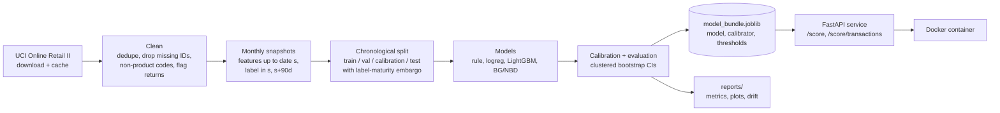

# Explainable customer inactivity prediction (DSA 8401 capstone)

An end-to-end, reproducible system that predicts which currently active wholesale customers will make **no purchase
in the next 90 days**, explains each prediction, and serves it through a containerised API.

- **Data:** UCI [Online Retail II](https://archive.ics.uci.edu/dataset/502/online+retail+ii) (CC BY 4.0): about 1.07M
  transaction lines of a UK online retailer with many wholesale customers, Dec 2009 to Dec 2011. It is raw: missing
  customer IDs, cancellations, non-product codes, duplicates and outliers.
- **Model:** calibrated LightGBM, compared with a fixed-recency rule, regularised logistic regression and a BG/NBD
  benchmark, validated strictly out of time.
- **Output:** a calibrated probability, a risk band (capacity-based) and the top reasons that raise the customer's risk.
- **Context:** this is the first stage of my MSc thesis, which later adds trade-credit delinquency as a second risk.

## Architecture



```
data/raw -> data/interim -> snapshots -> models -> artifacts/model_bundle.joblib -> API (Docker)
                                  \-> reports/ (results.md, metrics.json, reliability.png, shap_summary.png, ...)
```

## Quick start

Requires Python 3.10+ (developed and tested on 3.12). Docker is only needed for the container.

```bash
python -m venv .venv
.venv\Scripts\activate          # Windows;  source .venv/bin/activate on macOS/Linux
pip install -r requirements.lock.txt && pip install -e . --no-deps   # exact tested versions
#   or: pip install -r requirements.txt                              # minimum versions, latest releases

python -m inactivity all        # download data, clean, train, evaluate, write artifacts and reports
python -m inactivity predict --date 2011-08-31      # score every customer at a date (no retraining)
python -m pytest -q             # 43 tests, no data download needed
python -m inactivity serve      # API on http://localhost:8000  (docs at /docs)
```

**What to expect.** The first `all` run downloads a 45 MB workbook, then takes about 5 minutes on a laptop (about 1 minute to read and
clean the workbook, about 4 minutes to tune, train, evaluate and write everything). Later runs reuse the downloaded file. Results are
deterministic: a run from a clean environment reproduced every reported metric, interval, split and prediction exactly.

`python -m inactivity all` is the single command that reproduces everything from the public source. Individual stages:
`prepare`, `train`, `predict`, `serve`, `demo` (rebuild the UI data without retraining). Useful flags: `--synthetic` (offline
smoke run on generated data; it writes into `reports/` and `artifacts/`, so do not use it on top of real results),
`--no-sensitivity` (skip the horizon and label sensitivity runs), `--no-mlflow`, and for `predict`: `--out file.csv` and
`--include-ineligible`.

`predict` writes a CSV with one row per customer who ordered in the last 180 days, ranked by risk: calibrated probability, risk band,
the top three reasons, and the model version.

**Reproducibility safeguards.**
- `requirements.lock.txt` pins every package; `requirements-serve.txt` pins the container's runtime to the same versions.
- The trained bundle records the library versions it was built with; the API warns, and `GET /model-info` reports a
  `version_mismatch`, if the serving environment differs (a pickled model is only guaranteed to load faithfully under the same versions).
- The input workbook is checked for the expected columns, and its SHA-256 is recorded in `reports/data_quality.json` and compared
  with the hash in `configs/config.yaml`; a different file triggers a warning.

If the download is blocked, place `online_retail_II.xlsx` (from the UCI zip) in `data/raw/` and rerun.

## Web UI

Start the API (`python -m inactivity serve` or Docker) and open **http://localhost:8000/**. The API serves the interface
itself (no extra service, no external libraries, charts drawn as inline SVG, light or dark following the system setting).
It has seven pages behind a sidebar; each page keeps its filters while you move around.

| Page | What it does |
|---|---|
| **Overview** | Twelve KPIs (portfolio and model), histogram of predicted risk by band, the highest-spend customers at risk |
| **Explore data** | Data funnel; monthly activity with a measure and date-range selector; revenue concentration (Lorenz curve) and countries; four distributions with a log toggle; lapse rate by snapshot coloured by train/validation/calibration/test block; a feature explorer (any feature, any block, ranked by lapse-rate spread, click to open); Spearman correlation heatmap with a strength slider |
| **Model evidence** | Model comparison with bootstrap intervals and a metric toggle; cumulative gains and calibration with series toggles; stability across test months; permutation importance; drift; segment and label-sensitivity tables |
| **Retention worklist** | All customers at the final test date; band, search, minimum-spend and recency filters; sortable columns; risk-against-spend scatter; a "top N calls" back-test; CSV export |
| **Customer** | `#/customer/<id>`: risk, reasons, percentile comparison, order timeline with the next 90 days as hindsight, and a what-if panel that re-scores through `POST /score` as you move the sliders |
| **Try it** | Replay a real test-period customer, or paste order lines and score them with the training feature code |
| **About** | Definitions, glossary and limits |

The pages read `artifacts/trust.json`, `artifacts/worklist.json`, `artifacts/eda.json` and
`artifacts/demo_customers.json`, which `python -m inactivity train` writes. Regenerate them from the existing model
without retraining with `python -m inactivity demo`. Anything that uses outcomes unknown at the scoring date is labelled
**back-test** or **hindsight**. Interactive API docs are at `/docs`.

## API

```bash
python scripts/smoke_test_api.py http://localhost:8000
```

| Endpoint | Purpose |
|---|---|
| `GET /` | the web UI described above |
| `GET /eda` | exploratory aggregates for the Explore page |
| `GET /trust` | evaluation evidence for the trust page (metrics, intervals, curves, drift) |
| `GET /worklist` | ranked customers at the final test snapshot, with reasons and order history |
| `GET /demo/customers` | real test-period examples used by the Try it tab |
| `GET /health` | liveness and model version |
| `GET /model-info` | feature list, risk thresholds, test metrics of the loaded bundle |
| `POST /score` | snapshot **features** in, calibrated probability, risk band and reason codes out |
| `POST /score/transactions` | a customer's raw **transaction lines** in; features are computed by the same code used in training |

Example (`POST /score/transactions`):

```json
{"customer_id": "demo-1", "snapshot_date": "2011-03-31",
 "transactions": [{"invoice": "500001", "stock_code": "85123", "invoice_date": "2011-01-10T10:00:00",
                   "quantity": 12, "price": 2.5}]}
```

returns `probability_inactive`, `risk_band` (High/Medium/Low), up to three `reason_codes`, `model_version`, and
`"risk_band": "Not eligible"` with a null probability when the customer has not bought in the last 180 days.

## Docker

```bash
docker compose up --build        # serves on http://localhost:8000
docker compose ps                # health status
python scripts/smoke_test_api.py
```

The image contains only the serving dependencies (`requirements-serve.txt`), the source, and the committed
`artifacts/model_bundle.joblib`. Rebuild after retraining.

## Results (real data, out-of-time test, 3 monthly snapshots Jun-Aug 2011)

Data after cleaning: 794,161 lines for 5,875 customers from 1,067,371 raw rows (22.8% of raw rows had no customer
ID; 34,337 duplicates were removed). Eligible customer-snapshot rows: train 8,910, validation 8,917, calibration
9,985, test 8,256. Full tables, intervals and the raw JSON are in [`reports/results.md`](reports/results.md) and
`reports/metrics.json`; every value below comes from the run that produced `artifacts/model_bundle.joblib`.

| Model (test) | ROC-AUC [95% CI] | PR-AUC [95% CI] | Top-decile lift |
|---|---|---|---|
| Prevalence only | 0.500 | 0.440 | 1.00 |
| Fixed recency rule | 0.662 [0.647, 0.677] | 0.595 [0.574, 0.618] | 1.55 |
| Decision tree (depth 4) | 0.731 [0.716, 0.746] | 0.628 [0.608, 0.650] | 1.71 |
| Logistic regression (calibrated) | 0.760 [0.746, 0.775] | 0.686 [0.663, 0.710] | 1.79 |
| Neural network (MLP challenger) | 0.759 [0.744, 0.773] | 0.662 [0.637, 0.684] | 1.62 |
| Random forest | 0.766 [0.753, 0.781] | 0.689 [0.665, 0.712] | 1.80 |
| BG/NBD benchmark | 0.765 [0.751, 0.779] | 0.696 [0.673, 0.719] | 1.82 |
| **LightGBM (calibrated), served by the API** | **0.771 [0.757, 0.785]** | **0.693 [0.670, 0.715]** | **1.79** |

**What the numbers say**

- The model clearly beats the fixed recency rule a business would use today: ROC-AUC higher by +0.094 to +0.123
  (95% paired bootstrap interval), and clearly beats a single tree.
- It is **not clearly better** than the other sensible models. Against logistic regression the ROC-AUC gain is
  +0.005 to +0.016 and the PR-AUC and lift gaps span zero. Against the random forest it is
  +0.001 to +0.007 (PR-AUC gap spans zero) and against BG/NBD the gap spans zero. The tuned
  neural network did **not** beat it (LightGBM ahead by +0.004 to +0.019 ROC-AUC and
  +0.012 to +0.048 PR-AUC), which is why deep learning is not used. Most of the achievable signal is simple.
- Performance is stable across the three test snapshots (ROC-AUC 2011-06-30: 0.778, 2011-07-31: 0.777, 2011-08-31: 0.762).
- **Honesty checks.** LightGBM scored 0.723 ROC-AUC on the validation period used to tune it and
  0.771 on the test period (its dates were fixed in advance and nothing was chosen on it, but its results were visible during development). The test score is higher, not lower, so there is no sign of
  overfitting the validation set, but it also shows that skill moves by several points between periods. Retraining with every
  test-period customer removed (group-leakage check; only 3,620 training rows were left) gave
  0.753 ROC-AUC on those customers, within 0.018 of the served model, so
  familiarity with a customer is not what drives the score.
- **Calibration is the weak spot.** The inactivity rate was 58% in the calibration period but 44% in the test period (a
  prevalence shift between seasons), so probabilities fitted on the calibration block overstate risk on the test block
  (calibration intercept -0.51; ECE 0.096 versus 0.068 for the
  uncalibrated model). The ranking is trustworthy; treat the percentage as a priority score and recalibrate on recent data
  before any decision depends on it. The risk bands inherit this: High means calibrated probability at least 0.85,
  Medium at least 0.75.
- **Not equally good for every customer.** Ranking is weakest for small and one-off buyers (ROC-AUC
  0.64 for one-purchase-day customers, 0.63 for the lowest spend third)
  and strongest for regular, high-spend customers (0.75 and 0.75).
  Predicted risk is above the actual rate in every group.
- Sensitivity (LightGBM, 20 search trials): the fixed 60, 90 and 120-day horizons give similar skill. The segment-aware label looks
  much easier (ROC-AUC 0.897), but it is built partly from recency and the customer's
  order interval, which are also model inputs, so the gain is circular and is not evidence of better prediction.

| Sensitivity variant | Inactivity rate | ROC-AUC | PR-AUC |
|---|---|---|---|
| horizon 60d (fixed label) | 0.535 | 0.757 | 0.747 |
| horizon 90d (fixed label) | 0.440 | 0.771 | 0.693 |
| horizon 120d (fixed label) | 0.378 | 0.781 | 0.654 |
| horizon 90d (segment-aware label) | 0.149 | 0.897 | 0.567 |

Figures: [`reports/reliability.png`](reports/reliability.png), [`reports/shap_summary.png`](reports/shap_summary.png),
[`reports/sample_scores.csv`](reports/sample_scores.csv), [`reports/drift_psi.csv`](reports/drift_psi.csv) and
[`reports/permutation_importance.csv`](reports/permutation_importance.csv). The same evidence is browsable on the web UI's
first tab.

## Methodology in brief

| Topic | Decision |
|---|---|
| Target | no qualifying purchase in the 90 days after the snapshot date |
| Population | customers with a purchase in the previous 180 days (so dormant customers do not inflate AUC) |
| Snapshots | month-ends from 2010-02-28; only those whose label window closes before the last observed date |
| Splits | train / validation / calibration / test by date, with an embargo: a snapshot is dropped unless its label window ends before the next block starts |
| Models | prevalence and fixed-recency baselines, depth-4 decision tree, regularised logistic regression, random forest, a neural-network (MLP) challenger, a BG/NBD benchmark, and LightGBM tuned with a 60-trial Optuna TPE search on validation log loss |
| Calibration | Platt or isotonic, chosen by customer-grouped cross-validated Brier score on the calibration block |
| Metrics | ROC-AUC, PR-AUC, top-decile lift, Brier score, calibration slope/intercept, ECE; customer-clustered bootstrap CIs and paired differences |
| Explanations | TreeSHAP contributions for per-customer reasons; permutation importance on the test period for global importance |
| Sensitivity | 60/90/120-day horizons; a segment-aware label (gap above 3 times the customer's own median order interval) |

Full reasoning is in [`docs/technique_justification.md`](docs/technique_justification.md) (course-referenced: what was used,
tested and rejected, and where the project departs from course advice) and [`docs/design_decisions.md`](docs/design_decisions.md)
(framing and serving decisions).

## Report and slides

- [`docs/Final_Report.docx`](docs/Final_Report.docx): the final report (problem framing, data, method, system, results, technique justification, limits).
- [`docs/Presentation.pptx`](docs/Presentation.pptx): the 14-slide presentation, with speaker notes.
- Rebuild the report with `python scripts/make_figures.py && python scripts/build_report.py`.

## Repository layout

```
configs/config.yaml          all parameters (dates, horizon, search budget, bands)
src/inactivity/
  data.py                    download, schema and hash checks, cleaning rules + data-quality report
  features.py                snapshot features and labels (single code path for batch and API)
  splits.py                  chronological blocks with label-maturity embargo
  models.py                  baselines, logistic regression, LightGBM, BG/NBD, calibration
  evaluate.py                metrics, calibration diagnostics, clustered bootstrap
  explain.py                 TreeSHAP reason codes
  monitoring.py              PSI drift report
  pipeline.py, predict.py, cli.py   orchestration, batch prediction and command line
  versions.py                library versions stored with the model and checked when serving
  service/                   FastAPI app, schemas and the single-page web UI (static/index.html)
  demo.py, uidata.py         build the demo customers, worklist and trust-page data for the UI
  synthetic.py               generated raw-format data for tests and offline smoke runs
tests/                       43 tests: cleaning, leakage, embargo, metrics, API and training/serving parity
artifacts/                   trained bundle (committed so the container builds without retraining)
reports/                     metrics, plots, drift and data-quality outputs written by the pipeline
Dockerfile, docker-compose.yml, requirements*.txt, Makefile, scripts/
AI_USE.md                    AI-assistance disclosure
```

## Limitations

- About 24 months of history: training uses early 2010 and testing mid-2011, so seasonality and business change
  can matter. The drift report quantifies input shift.
- Monthly snapshots overlap, so rows of the same customer are correlated; intervals use a customer-clustered
  bootstrap, but effective sample size is smaller than the row count.
- One UK online retailer: results do not transfer to other businesses without re-validation.
- Rows with a missing customer ID (22.8% of raw rows) are dropped.
- **History is left-censored at Dec 2009**, so features such as tenure, number of purchase days and 365-day order
  counts grow mechanically with calendar time. The drift report shows major shifts for exactly these features
  between the training period and the test period. A production version should cap history windows or drop
  tenure-type features.
- Probabilities are not well calibrated across seasons (see Results); use them to rank customers.
- **Docker was verified once, on one machine.** The image (656 MB) was built with `docker compose build`, the container reported healthy,
  served the web interface and API, and `scripts/smoke_test_api.py` scored a customer through it with no library-version warning
  (Docker Desktop 25.0.3, Linux containers, 2026-10-04). It has not been tried on another operating system or a CI runner.

## Data licence and credit

Online Retail II, UCI Machine Learning Repository, CC BY 4.0. The dataset is downloaded at run time and is not
redistributed in this repository.
